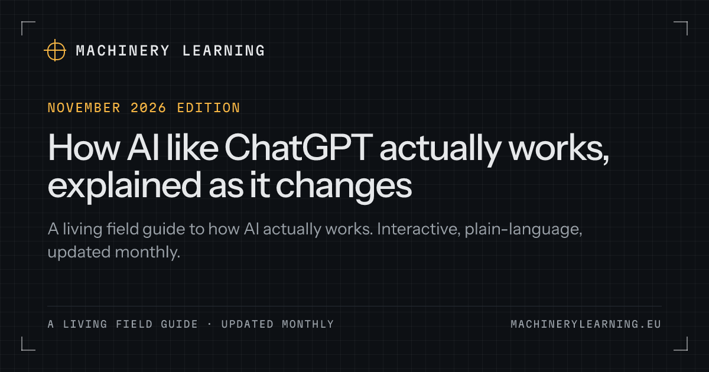

# Machinery Learning

**A living field guide to how AI actually works.** [machinerylearning.eu](https://machinerylearning.eu)

[](https://github.com/rhaist/machinery-learning/actions/workflows/deploy.yml)
[](LICENSE)
[](LICENSE-CONTENT)



Most of us use AI tools every day without knowing what happens between typing a question and getting an answer. This guide explains it from the ground up, for two kinds of reader at once: each chapter is written in plain language with everyday analogies, and boxes marked *Engineer* fold open with the technical detail.

- **Part 1: Language models.** Tokens, attention, training, generation and limits. Eight chapters, each with a hands-on demo.
- **Part 2: Agents.** The agent loop; context, memory, plug-ins and sandboxes; what agents get done; the models and software around the model; how to tell when they fail. Five chapters.
- **Part 3: Trust & security.** Prompt injection, agent permissions, the AI supply chain, where your data goes, what AI is doing to the security industry, and how to judge AI claims. Six chapters with interactive labs.
- **Part 4: Looking ahead.** Where research is heading, and the guide's main points and habits on one page.

## How it stays honest

Every fact that can go out of date lives in a claims registry with its sources, the date it was last verified and a re-check interval. Overdue facts fade on the page until someone re-verifies them. The full list is on the [Sources & freshness](https://machinerylearning.eu/sources/) page.

Where experts disagree, the chapter presents both sides at their strongest, with named proponents, primary sources and the evidence that would settle the question.

Each month a research run drafts an update as a pull request (re-verified claims, radar moves, field notes), and a human reviews every change before it is published. The [frontier radar](https://machinerylearning.eu/radar/) keeps its full history.

The site sets no cookies, does no tracking and makes no third-party requests. Reading progress stays in your browser.

## Spotted an error?

Please [open an issue](https://github.com/rhaist/machinery-learning/issues/new/choose). There are templates for factual errors, broken sources and suggestions. Corrections with a primary source help most. See [CONTRIBUTING.md](CONTRIBUTING.md).

## Running it locally

Requires Node.js 22.12 or later (CI uses the current LTS, Node 26).

```sh
npm ci
npm run dev        # http://localhost:4321/
npm run check      # claims freshness (strict), design rules, production build
```

## How the repository is organised

| Path | What lives there |
|---|---|
| `src/content/chapters/` | Chapters in MDX: plain-language core, `<Engineer>` depth blocks, `<Claim>` facts, `<Debate>` boxes, quizzes |
| `src/data/claims.yaml` | Every time-sensitive fact, with sources, `verified` date and `half_life` |
| `src/data/debates.yaml` | "Where experts disagree": two sides, proponents, sources, what would settle it |
| `src/data/radar.yaml` | The frontier radar, with an append-only history per entry |
| `src/data/glossary.json`, `reading.yaml` | Glossary terms and further reading per chapter |
| `src/content/notes/` | Monthly field notes, each with the corrections made that month |
| `src/components/`, `src/scripts/` | Demos and labs (Astro components plus guarded client scripts) |
| `research/` | The brief and source list for the monthly update |
| `scripts/` | `check-data.mjs` (text in the data files is really text), `check-a11y.mjs` (axe on every built page; runs in CI), `check-claims.mjs` (freshness and integrity), `check-design.mjs` (design rules); `next-token-probs.py` (measures a small open model's next-word probabilities for three demos; run by hand, output in `src/data/next-token-probs.json`) |
| [`DESIGN.md`](DESIGN.md) | The design system: tokens, type, layout, signatures and the rules CI enforces |
| [`docs/MAINTAINING.md`](docs/MAINTAINING.md) | Deployment, domain, the monthly update and release checks |
| [`docs/REVIEW.md`](docs/REVIEW.md) | Brief for expert reviewers: what to read, what to look for, how to report |
| `src/data/figures.yaml` | Sources or calculations for every other number in the text |

Built with [Astro](https://astro.build), Instrument Sans and Martian Mono (both self-hosted), and no client-side framework.

## Licence

Code is MIT ([LICENSE](LICENSE)). Text, diagrams and data are CC BY-SA 4.0 ([LICENSE-CONTENT](LICENSE-CONTENT)): you may reuse and adapt them with attribution, under the same licence.

Maintained by Robert Haist. Drafts are written with AI assistance; a human reviews and verifies every change before it is published.
